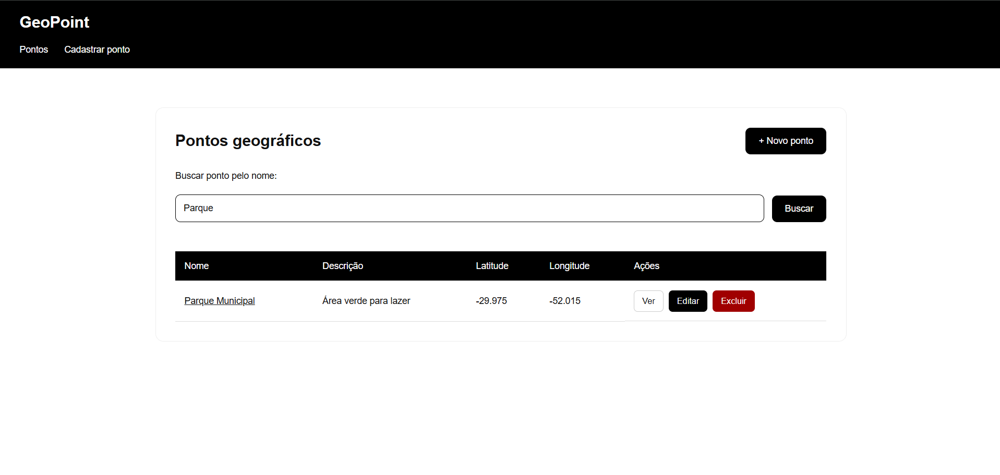
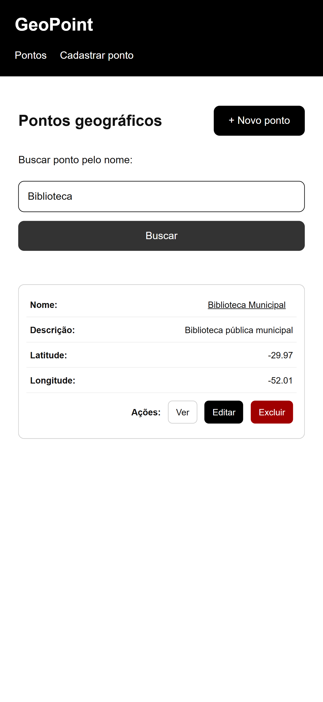
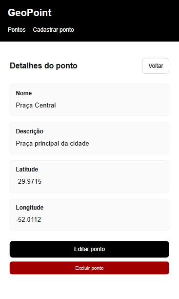

# GeoPoint — CRUD de Pontos Geográficos

## Autor

Nome: Maria Eduarda Radin

## Sobre o projeto

O GeoPoint é um projeto desenvolvido para o trabalho da G2 da disciplina de Frontend. O sistema permite cadastrar, listar, consultar, editar e excluir pontos geográficos, informando nome, descrição, latitude e longitude.

## Tecnologias utilizadas

- HTML
- CSS
- JavaScript
- Fetch API
- GeoPoint API

## Como executar o projeto

1. Baixe ou clone o repositório.
2. Abra a pasta do projeto.
3. Abra o arquivo `index.html` no navegador.
4. Utilize o menu para listar os pontos ou cadastrar um novo.

## API utilizada

URL da API:

https://geopoint-6x4u.onrender.com/api/points

A API é utilizada para cadastrar, listar, consultar, atualizar e excluir os pontos geográficos.

## Capturas de tela

### Listagem

  
  

### Filtro

  
  

### Cadastro

  
  

### Detalhe

  
  

### Edição

  
  